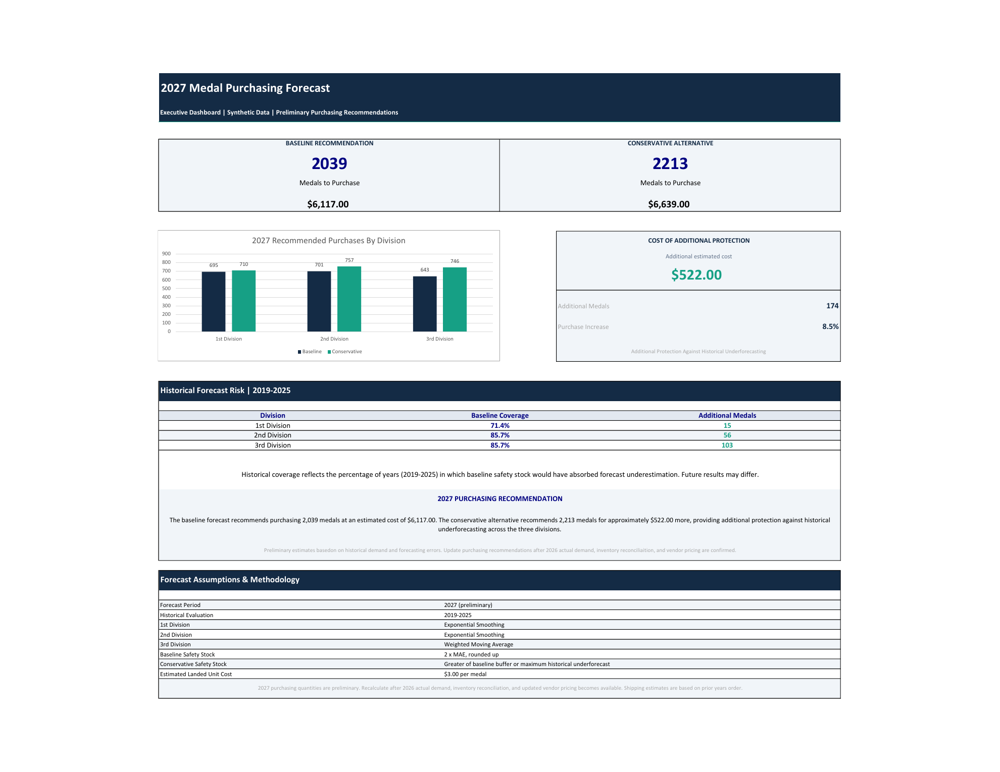

# medal-demand-forecasting
Excel-based demand forecasting, inventory planning, and purchasing scenario analysis using synthetic data
# Medal Demand Forecasting & Inventory Optimization

### Excel | Demand Forecasting | Inventory Planning | Business Analytics

## Executive Dashboard

## Project Overview

This project demonstrates an Excel-based forecasting and inventory planning solution for a fictional statewide marching competition.

The objective is to estimate future medal demand, evaluate forecasting methods, and develop purchasing recommendations that balance inventory availability against excess purchasing costs.

**All historical demand, purchasing, inventory, and pricing data in this project are synthetic.**

## Business Problem

Competition organizers must purchase medals before final demand is known. Ordering too few creates a risk of shortages, while ordering too many ties up funds in unused inventory.

Because unused medals can be carried into future years, purchasing decisions must consider both forecast demand and existing inventory.

## Analytical Approach

The project uses three forecasting methods:

- Three-year Simple Moving Average
- Weighted Moving Average
- Exponential Smoothing

Forecasting accuracy is evaluated using Mean Absolute Error (MAE), Mean Absolute Percentage Error (MAPE), and forecast bias.

The best-performing model for each medal division informs the inventory planning process.

## Inventory & Purchasing Analysis

The Excel model incorporates historical inventory balances, projected ending inventory, forecast demand, and safety stock.

Two purchasing scenarios are evaluated:

- **Baseline:** Safety stock based on twice the historical MAE.
- **Conservative:** Safety stock based on the greater of twice historical MAE or the largest historical underforecast.

## Key Results

| Metric | Baseline | Conservative |
|---|---:|---:|
| Recommended 2027 purchases | 2,039 medals | 2,213 medals |
| Estimated purchasing cost | $6,117 | $6,639 |

The conservative scenario recommends 174 additional medals at an incremental cost of $522, approximately 8.5% above the baseline purchasing cost.

These results illustrate the trade-off between purchasing costs and protection against demand uncertainty.

## Tools & Skills Demonstrated

- Microsoft Excel
- Time-series forecasting
- Forecast error analysis
- Inventory reconciliation
- Safety stock calculations
- Scenario analysis
- Excel formulas including SUMIF and INDEX/MATCH
- Executive dashboard development

## Project Files

The Excel workbook contains historical synthetic data, forecasting calculations, model comparisons, inventory analysis, and an executive dashboard.

## Data Disclaimer

This project uses fictional, synthetic data for portfolio demonstration purposes. Results are illustrative and do not represent actual competition demand, inventory, financial performance, or purchasing recommendations.
